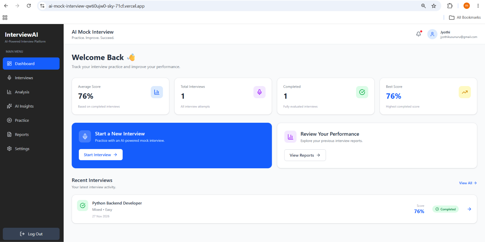

https://ai-mock-interview-qwti0ujw0-sky-71cf.vercel.app

# 🚀 Full-Stack AI Project

# AI Mock Interview Platform

### Practice Smarter. Improve Faster. Interview with Confidence.

An AI-powered, full-stack interview preparation platform designed to help candidates practice job interviews, receive intelligent feedback, evaluate their performance, and improve their interview skills.

**React · FastAPI · PostgreSQL · Google Gemini AI**

🌐 **[Live Demo](https://ai-mock-interview-qwti0ujw0-sky-71cf.vercel.app/)** | 💻 **[GitHub Repository](https://github.com/jyothikusunuru-sudo/ai-mock-interview)**

## 📌 01 — Project Overview

The **AI Mock Interview Platform** is a web-based application that brings artificial intelligence into interview preparation.

It provides an interactive environment where candidates can practice interview questions, submit their answers, receive AI-powered evaluations, and monitor their progress through a centralized dashboard.

By integrating Google Gemini AI with a modern full-stack architecture, the application aims to make interview preparation more accessible, structured, and effective.

## ✨ 02 — Key Features

### 🤖 1. AI-Powered Interview Question Generation

Generate relevant interview questions based on the selected job role, experience level, and difficulty. AI integration helps create a focused interview preparation experience.

### 🧠 2. Intelligent Answer Evaluation

Evaluate user-submitted interview answers using Google Gemini AI. Receive performance scores and AI-generated feedback to understand strengths and identify areas for improvement.

### 📊 3. Interview Performance Analytics

Monitor interview performance through scores, statistics, and previous interview activity. The dashboard provides an overview of progress and preparation performance.

### 📑 4. Detailed Interview Reports

Review completed interview results, evaluation scores, and feedback. Use these insights to understand performance and identify opportunities for improvement.

### 🎯 5. Multiple Interview Practice Modes

Practice different interview formats, including technical, behavioral, and quick questions, to prepare for a variety of interview scenarios.

### 👤 6. User Authentication

Register and log in to access a personalized interview preparation experience.

### 🖥️ 7. Interactive User Dashboard

Access interview statistics, recent interview activity, performance summaries, and application modules through a centralized dashboard.

## 🛠️ 03 — Technology Stack

| Layer | Technologies |
|---|---|
| Frontend | React.js, Vite |
| Styling | Tailwind CSS |
| Backend | Python, FastAPI |
| Database | PostgreSQL |
| AI Integration | Google Gemini API |
| Authentication | JWT, bcrypt |
| Deployment | Vercel, Render |

## 🏗️ 04 — Application Architecture

The application follows a full-stack architecture in which the frontend communicates with the backend through REST APIs. The backend manages application logic, database operations, authentication, and AI integration.

### Application Flow

1. User interacts with the React frontend.
2. Frontend sends requests to the FastAPI backend.
3. Backend processes requests and communicates with PostgreSQL.
4. Google Gemini AI handles interview question generation and answer evaluation.
5. Results are returned to the frontend and displayed on the dashboard.

## 📸 05 — Application Screenshots

### Dashboard — Interview Performance Overview

The dashboard provides users with a centralized view of their interview activity, performance scores, completed interviews, and recent practice sessions.

## 🎓 06 — What I Learned

Through developing this project, I gained practical experience in:

- Full-stack web application development.
- Building REST APIs using FastAPI.
- Frontend development using React and Vite.
- PostgreSQL database integration and management.
- AI integration using Google Gemini API.
- Authentication and backend security concepts.
- Connecting frontend and backend services.
- Cloud deployment using Vercel and Render.
- Debugging, troubleshooting, and deployment configuration.

## 🌐 07 — Live Application

Try the deployed application:

**[Launch AI Mock Interview Platform](https://ai-mock-interview-qwti0ujw0-sky-71cf.vercel.app/)**

## 👨‍💻 08 — Developer

Developed as a full-stack AI project to explore practical applications of artificial intelligence in interview preparation.

### ⭐ If you find this project interesting, feel free to explore the repository!

**Built with ❤️ to make interview preparation smarter and more effective.**

